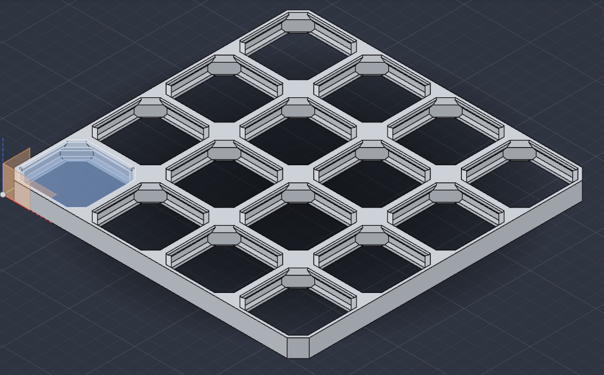
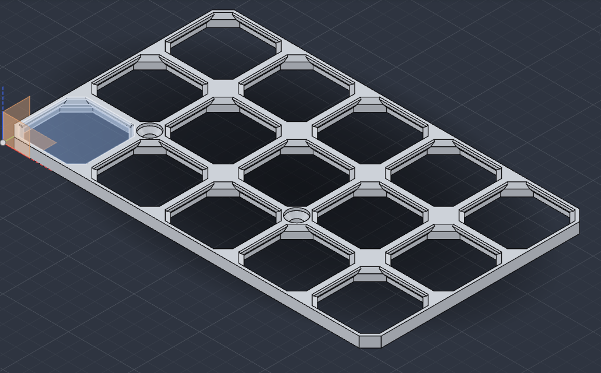
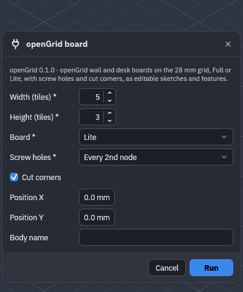
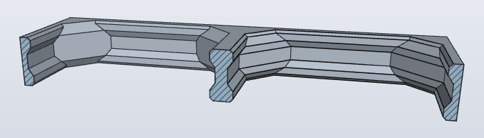

# openGrid for SolidCraft

A [SolidCraft](https://github.com/tangency-labs/solidcraft) plugin that makes
[openGrid](https://www.printables.com/model/1214361-opengrid-walldesk-mounting-framework-and-ecosystem) boards:
the open wall and desk mounting system on a 28 mm grid. Choose the size, Full or Lite, and where the
screw holes go, and it builds the board as ordinary SolidCraft features (sketches, lofts, patterns and
combines) that you can edit like anything you drew yourself. They go in one folder in the History bar,
named like the board.

| A 4x4 Full board | A 5x3 Lite board with screw holes |
|---|---|
|  |  |

| The form in SolidCraft | The opening, cut through |
|---|---|
|  |  |

## What it makes
- **Full** boards, 6.8 mm thick: the same front and back, for every openGrid snap. Mount them with
  openGrid's mounting snaps, or with screw holes.
- **Lite** boards, 4 mm thick: the front of a Full board with a flat back, screwed straight to the wall.
- **Screw holes** where the grid lines cross, on every node, every 2nd or every 3rd (never on the
  edge): countersunk for 4 mm wood screws, the head 1 mm below the face.
- The board's four outer corners cut off, as openGrid's are (can be turned off).
- Any size from 1x1 to 100 tiles, as long as it builds in time (see below).

The tile follows openGrid's dimensions: a 25 mm opening that widens to 26.4 mm inside, 45° chamfers
at both faces and a corner block in each corner, so openGrid snaps and accessories fit.

> Status: early (0.2.0), not printed yet: please report how snaps fit. Tested with SolidCraft 0.42.0
> and 0.43.0 on Linux. On macOS, use SolidCraft 0.43 or newer: 0.41 and 0.42 crash there when any
> plugin runs ([SolidCraft issue #16698](https://github.com/tangency-labs/solidcraft/issues/16698),
> fixed in 0.43).

## Install
Download `opengrid-0.2.0.zip` from the [latest release](../../releases/latest), then in SolidCraft:
**Plugins › Install plugin…** and pick the zip. Run it from **Plugins › openGrid board** (or its
button in the ribbon).

## Big boards take time
SolidCraft gives a plugin 30 seconds, and every change to a big body takes it a while. The plugin
builds one tile, copies it into a row and the row into a board, and cuts screw holes into blocks of
rows before they are joined, but a large board with many holes still takes long. Measured in the
desktop app on Linux:

| Board | Time |
|---|---|
| Full 8x8, no screw holes | 13 s |
| Full 10x10, no screw holes | 20 s |
| Lite 8x8, holes every 2nd node | 14 s |
| Lite 10x10, holes every 2nd node | 19 s |
| Full 8x8, holes every 2nd node | 20 s |
| Full 6x6, holes on every node | 26 s |

The plugin estimates the time before it starts, and says so if a board would take too long: make it
smaller, use fewer screw holes, or a Lite board. A wall of boards prints better as several boards anyway.

## Parameters
| Key | Form | Default |
|---|---|---|
| `width`, `height` | Width and Height in tiles of 28 mm (at most 100 tiles) | 4, 4 |
| `board` | Board: "Full" or "Lite" | Full |
| `screw_holes` | Screw holes: "None", "Every node", "Every 2nd node", "Every 3rd node" | None |
| `corner_chamfers` | Cut corners | true |
| `position_x`, `position_y` | Corner of the board (mm) | 0 |
| `title` | Body name | openGrid and the size |

From a script, inspect the package to get its approval hash, then run the `board` entry:

```json
{"commands": [
  {"command": "plugin.run", "params": {
    "path": "/path/to/plugins/opengrid", "approval": "<hash from plugin.inspect>", "entry": "board",
    "params": {"width": 6, "height": 4, "board": "Lite", "screw_holes": "Every 2nd node"}}}
]}
```

## Not yet
- The connector slots on the edges of Full boards, for joining boards side by side.
- Snaps and accessories.

## Build
Needs Rust with the `wasm32-unknown-unknown` target and `wasm-tools`. `./build.sh` runs the tests,
builds the WebAssembly component and writes `package/opengrid-<version>.zip`.

## Credits and licence
openGrid is by [David D](https://www.printables.com/@DavidD), released under CC BY 4.0. The tile's
dimensions here come from the openGrid generator in
[openGrid-Studio](https://github.com/ClassicOldSong/openGrid-Studio) (Apache 2.0), which credits
David D, Hands on Katie and her community, Pedro Leite and mitufy. This plugin is not made or endorsed
by them.

The plugin's code is MIT, see [LICENSE](LICENSE). The plugin interface in `plugin/wit/` is
SolidCraft's (Apache 2.0), see [NOTICE](NOTICE).
